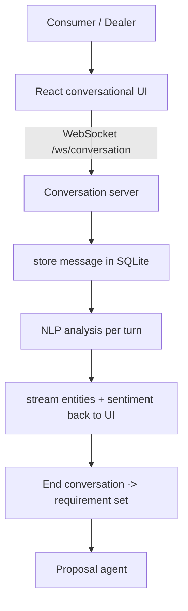

# Conversational CRM Application

**Code paths:** `frontend/app/chat/page.jsx, frontend/lib/api.js, backend/app/routers/conversations.py`

## Purpose
The single entry point where a consumer and a dealer talk over text or voice. Each message is recorded, streamed back with live NLP analysis, and finally closed into a structured requirement set.

## Flowchart

## Notes
Every module runs with zero external services (SQLite + deterministic fallbacks) and upgrades automatically when PostgreSQL/Mongo/Kafka/Spark/Whisper/LLM keys are provided.
