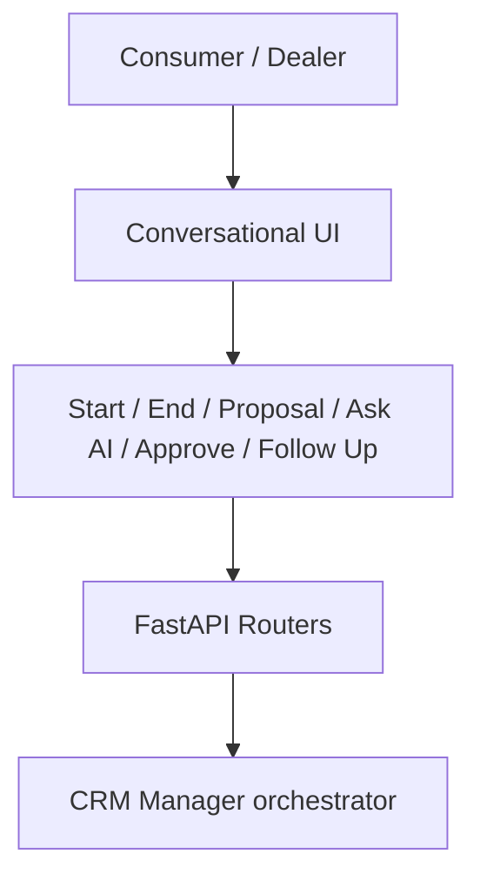

# Conversational CRM Application

**Code paths:** `frontend/app/chat/page.jsx, backend/app/routers/`

## Purpose
The single entry point where a consumer and a dealer talk. Every button maps to one API call that the agent layer fulfils.

## Flowchart

## Source
See `frontend/app/chat/page.jsx, backend/app/routers/` in this repository.
