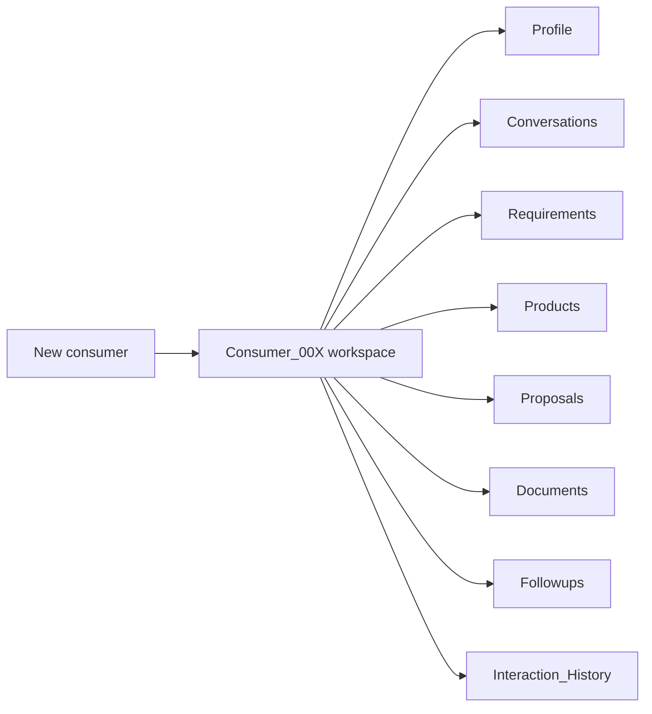

# Consumer-Specific Digital Workspace

**Code paths:** `backend/app/routers/workspace.py`

## Purpose
Auto-created folder per consumer with 8 standard sections, written by agents as interactions happen.

## Flowchart

## Source
See `backend/app/routers/workspace.py` in this repository.
