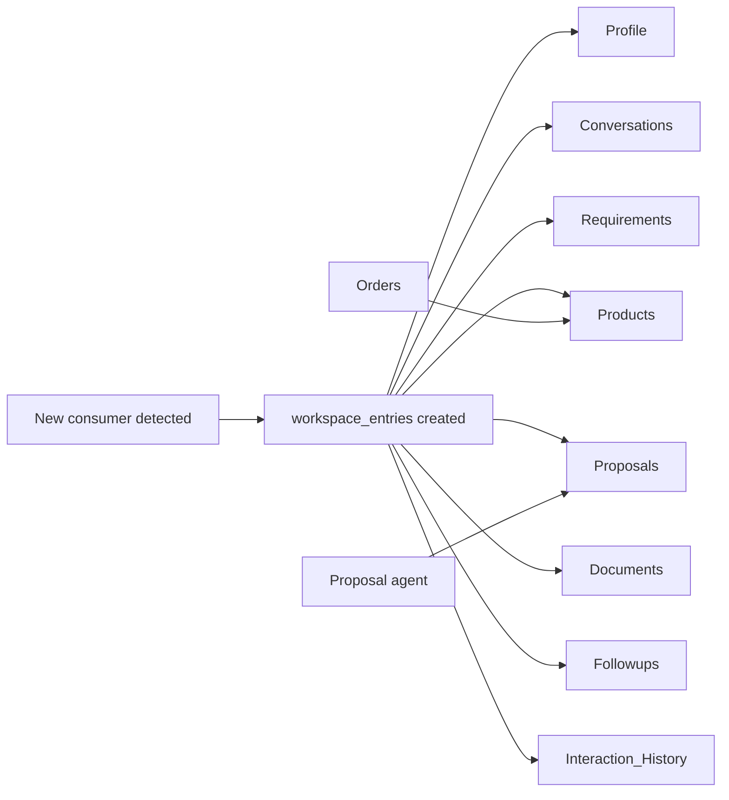

# Consumer-Specific Digital Workspace

**Code paths:** `backend/app/services/crm.py (workspace, write_workspace), backend/app/routers/workspace.py`

## Purpose
Every consumer gets an auto-created workspace with eight standard sections that agents fill as interactions happen. Backed by the workspace_entries table.

## Flowchart

## Notes
Every module runs with zero external services (SQLite + deterministic fallbacks) and upgrades automatically when PostgreSQL/Mongo/Kafka/Spark/Whisper/LLM keys are provided.
