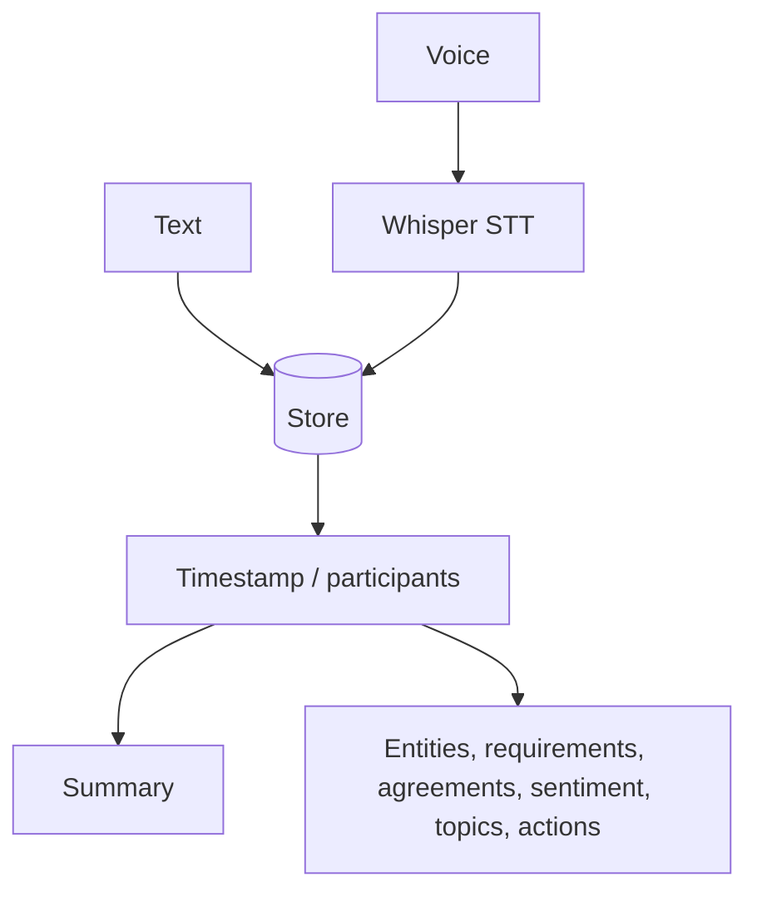

# Conversation Recording System

**Code paths:** `backend/app/services/stt.py, backend/app/routers/conversations.py`

## Purpose
Voice is transcribed with open-source Whisper; every exchange is timestamped, summarised and entity-tagged.

## Flowchart

## Source
See `backend/app/services/stt.py, backend/app/routers/conversations.py` in this repository.
