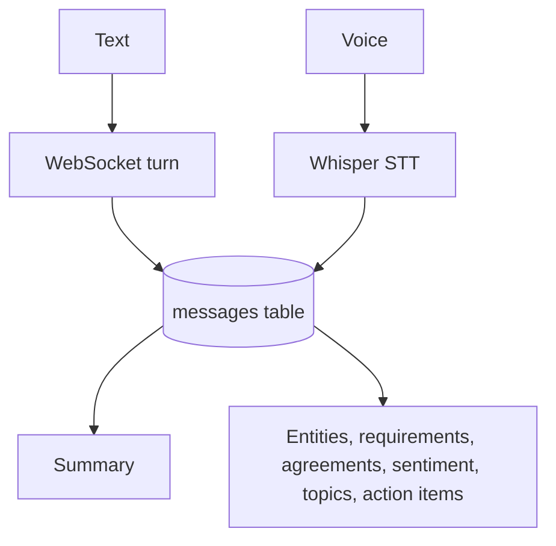

# Conversation Recording System

**Code paths:** `backend/app/services/stt.py, backend/app/services/crm.py (start_conversation), backend/app/repository.py`

## Purpose
Voice is transcribed with open-source Whisper; every exchange is persisted with role, timestamp and conversation id, then summarised and entity-tagged.

## Flowchart

## Notes
Every module runs with zero external services (SQLite + deterministic fallbacks) and upgrades automatically when PostgreSQL/Mongo/Kafka/Spark/Whisper/LLM keys are provided.
