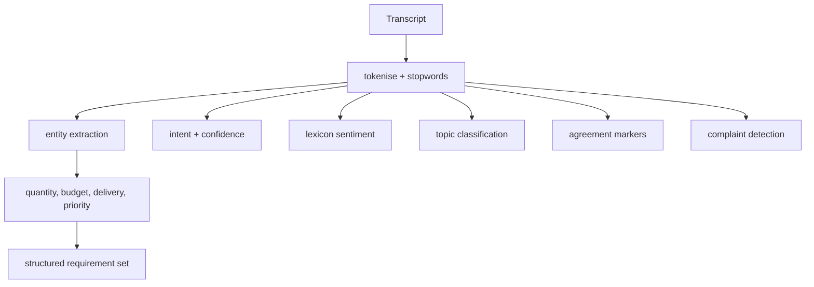

# NLP Conversation Intelligence

**Code paths:** `backend/app/services/nlp.py`

## Purpose
Conversations are understood, not just stored: intent with confidence scores, lexicon sentiment, NER-style extraction of quantities/budgets/dates/locations, topic classification, agreement and complaint detection, extractive summarisation and cosine similarity.

## Flowchart

## Notes
Every module runs with zero external services (SQLite + deterministic fallbacks) and upgrades automatically when PostgreSQL/Mongo/Kafka/Spark/Whisper/LLM keys are provided.
