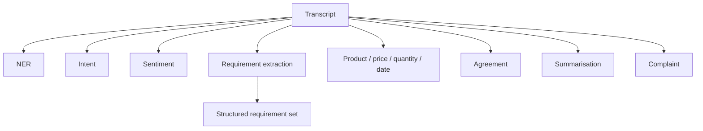

# NLP Conversation Intelligence

**Code paths:** `backend/app/services/nlp.py`

## Purpose
Conversations are understood, not just stored: intent, sentiment, NER-style extraction, summarisation, complaints, semantic similarity.

## Flowchart

## Source
See `backend/app/services/nlp.py` in this repository.
