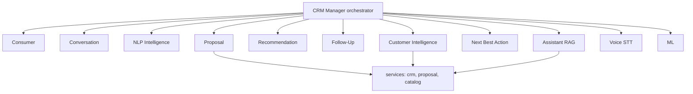

# Multi-Agent AI Architecture

**Code paths:** `backend/app/agents/agents.py, backend/app/routers/ops.py`

## Purpose
Eleven specialised agents (consumer, conversation, NLP, proposal, recommendation, follow-up, customer intelligence, next-action, assistant/RAG, voice, ML) coordinated by the CRM Manager agent.

## Flowchart

## Notes
Every module runs with zero external services (SQLite + deterministic fallbacks) and upgrades automatically when PostgreSQL/Mongo/Kafka/Spark/Whisper/LLM keys are provided.
