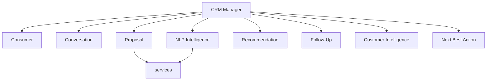

# Multi-Agent AI Architecture

**Code paths:** `backend/app/agents/agents.py`

## Purpose
Eight specialised agents coordinated by the CRM Manager agent, each owning a domain of CRM work.

## Flowchart

## Source
See `backend/app/agents/agents.py` in this repository.
