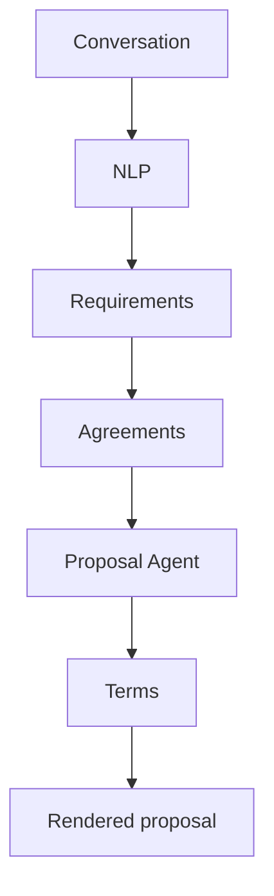

# Automated Proposal Generation

**Code paths:** `backend/app/services/proposal.py, backend/app/routers/proposals.py`

## Purpose
Agreed terms are extracted from the conversation and rendered into a structured proposal.

## Flowchart

## Source
See `backend/app/services/proposal.py, backend/app/routers/proposals.py` in this repository.
