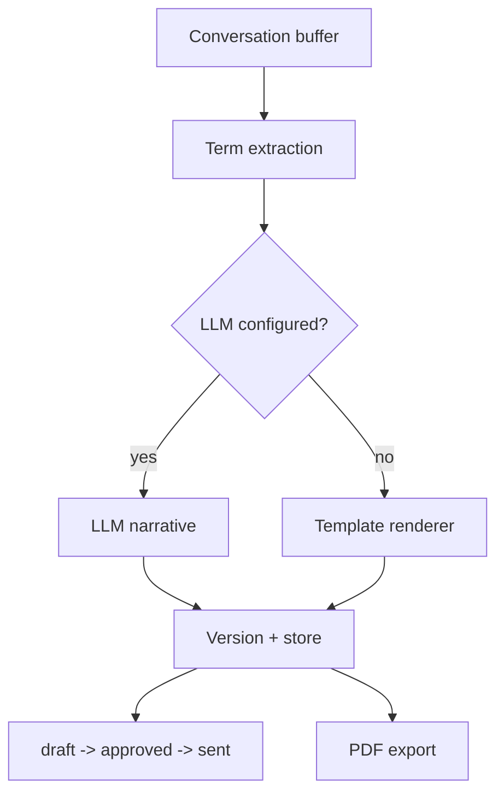

# Automated Proposal Generation

**Code paths:** `backend/app/services/proposal.py, backend/app/services/llm.py, backend/app/routers/proposals.py`

## Purpose
Agreed terms are extracted from the conversation and rendered into a structured proposal — via an LLM when a key is configured, otherwise a deterministic template. Stored with versioning, status workflow and PDF export.

## Flowchart

## Notes
Every module runs with zero external services (SQLite + deterministic fallbacks) and upgrades automatically when PostgreSQL/Mongo/Kafka/Spark/Whisper/LLM keys are provided.
