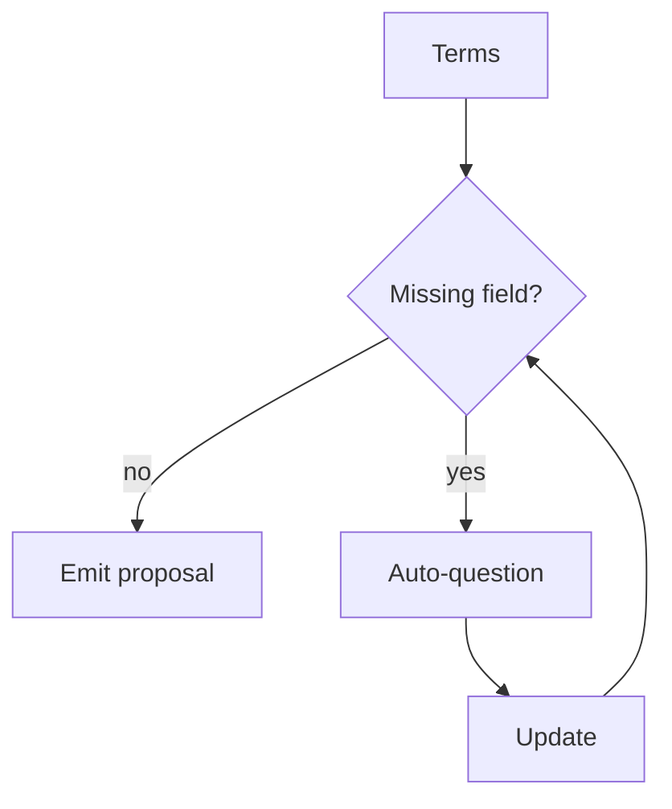

# Intelligent Missing-Information Detection

**Code paths:** `backend/app/services/proposal.py (missing_information)`

## Purpose
Before a proposal is finalised the AI detects absent fields and asks the dealer for them automatically.

## Flowchart

## Source
See `backend/app/services/proposal.py (missing_information)` in this repository.
