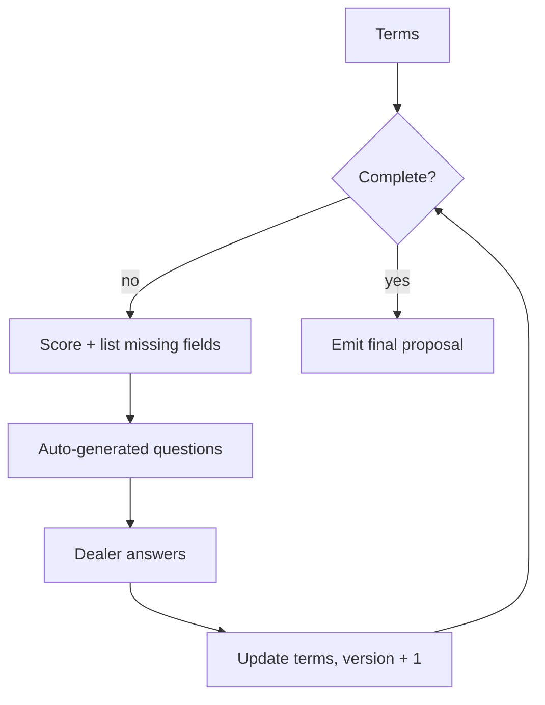

# Intelligent Missing-Information Detection

**Code paths:** `backend/app/services/proposal.py (completeness, missing_information), backend/app/routers/proposals.py (ask-missing)`

## Purpose
Before a proposal is finalised the system scores completeness and asks the dealer for every absent field, then re-renders the proposal at the next version.

## Flowchart

## Notes
Every module runs with zero external services (SQLite + deterministic fallbacks) and upgrades automatically when PostgreSQL/Mongo/Kafka/Spark/Whisper/LLM keys are provided.
