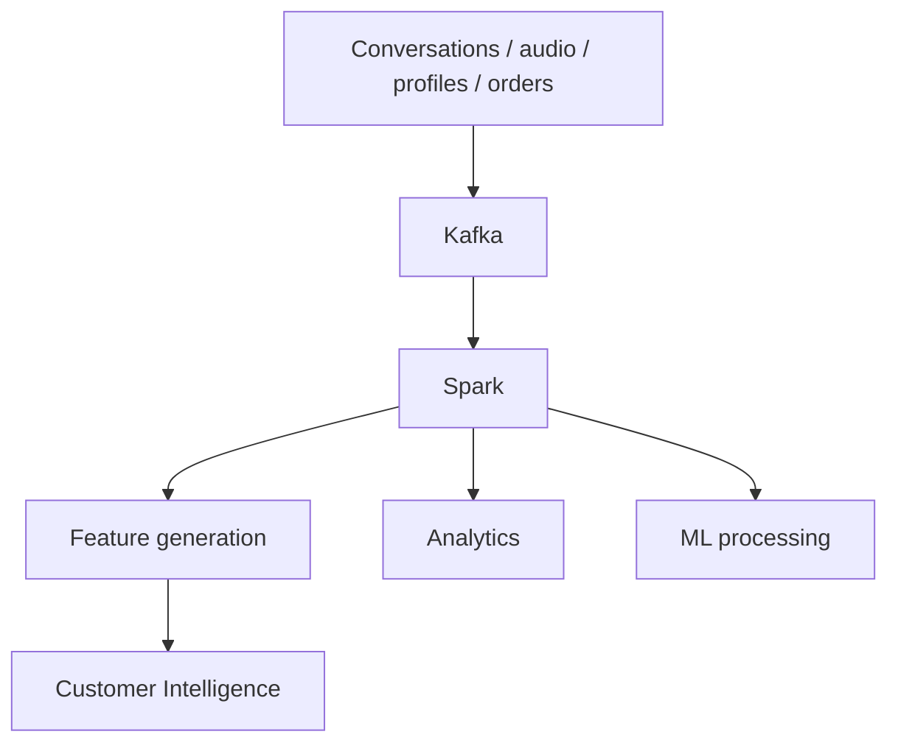

# Big Data Architecture & Processing

**Code paths:** `backend/app/streaming/kafka_bus.py, spark_job.py`

## Purpose
Kafka streams conversation events, Spark performs large-scale analytics and ML feature generation.

## Flowchart

## Source
See `backend/app/streaming/kafka_bus.py, spark_job.py` in this repository.
