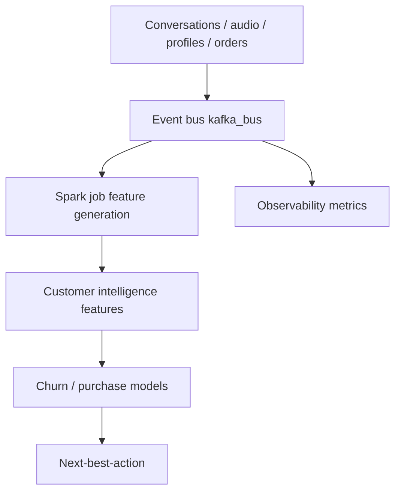

# Big Data Architecture & Processing

**Code paths:** `backend/app/streaming/kafka_bus.py, backend/app/streaming/spark_job.py, backend/app/observability.py`

## Purpose
Kafka-style event bus for conversation events, Spark-style batch feature generation hooks, plus streaming metrics. Both degrade to stubs when the libraries are absent.

## Flowchart

## Notes
Every module runs with zero external services (SQLite + deterministic fallbacks) and upgrades automatically when PostgreSQL/Mongo/Kafka/Spark/Whisper/LLM keys are provided.
