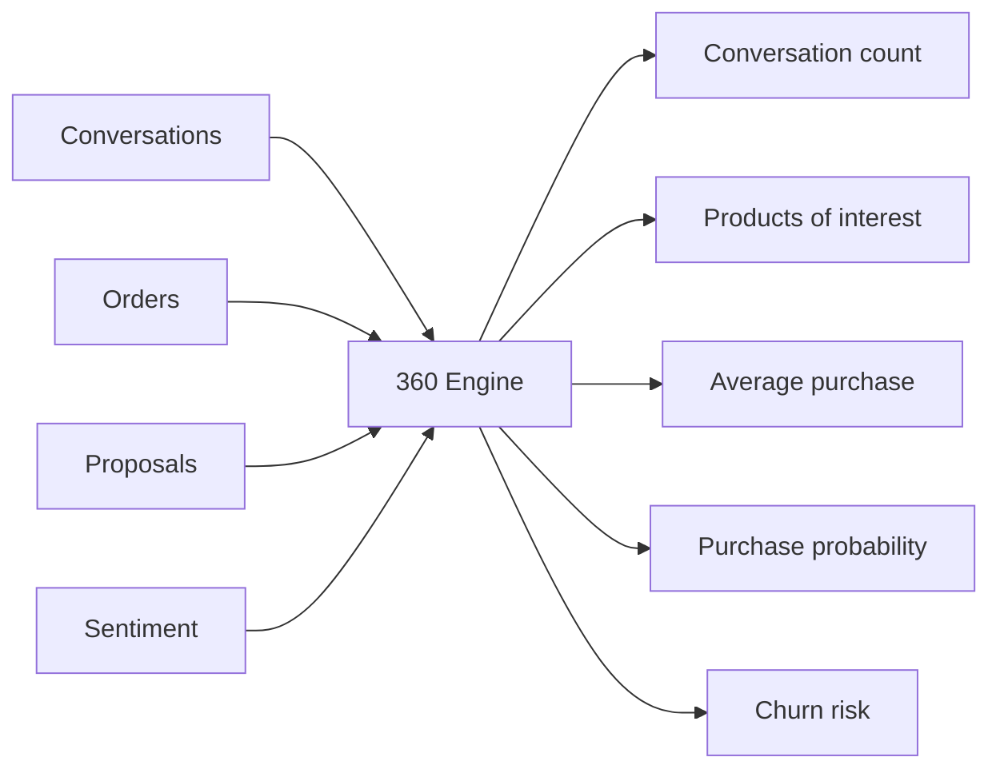

# Customer 360° Intelligence

**Code paths:** `backend/app/routers/analytics.py`

## Purpose
A complete AI-generated view of each consumer assembled from conversations, orders, memory and predictions.

## Flowchart

## Source
See `backend/app/routers/analytics.py` in this repository.
