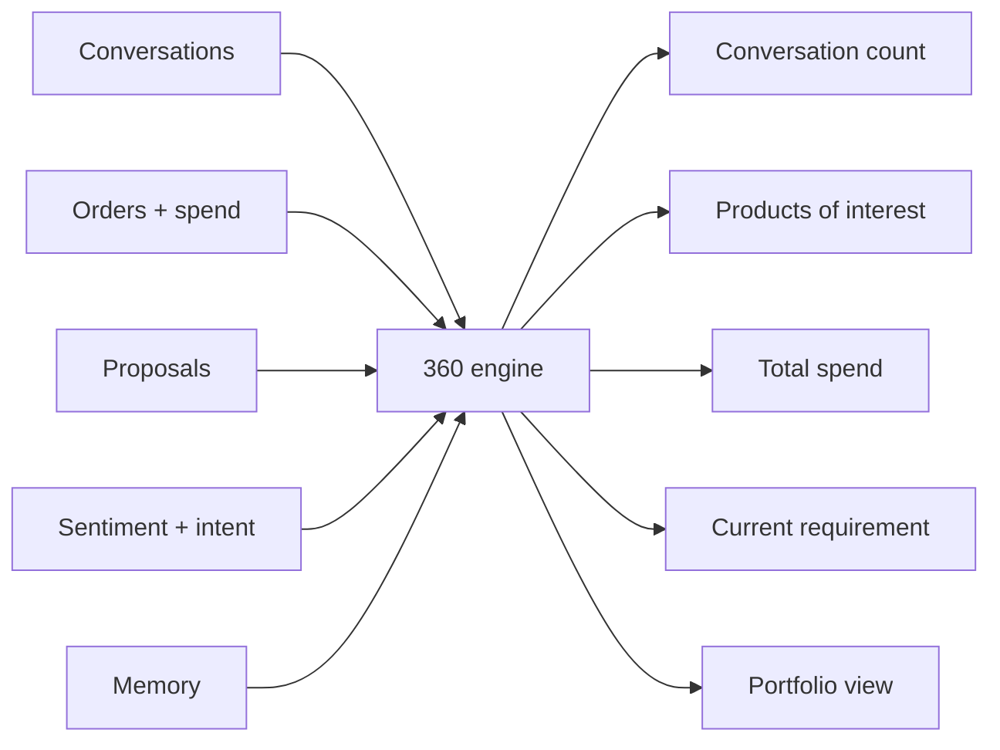

# Customer 360° Intelligence

**Code paths:** `backend/app/services/crm.py (customer_360), backend/app/routers/analytics.py`

## Purpose
A complete AI-generated view of each consumer assembled from conversations, orders, proposals, memory and sentiment, exposed per-customer and as a dealer portfolio.

## Flowchart

## Notes
Every module runs with zero external services (SQLite + deterministic fallbacks) and upgrades automatically when PostgreSQL/Mongo/Kafka/Spark/Whisper/LLM keys are provided.
