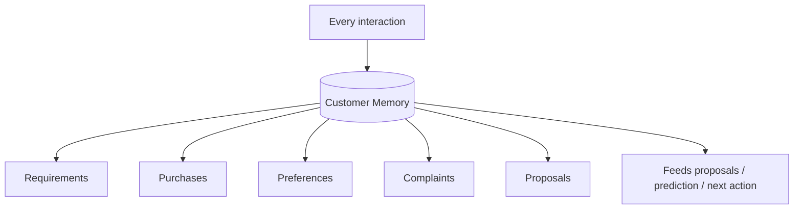

# Customer Memory Layer

**Code paths:** `backend/app/services/memory.py`

## Purpose
Long-term memory of requirements, purchases, preferences, complaints, proposals, negotiations, agreements and history.

## Flowchart

## Source
See `backend/app/services/memory.py` in this repository.
