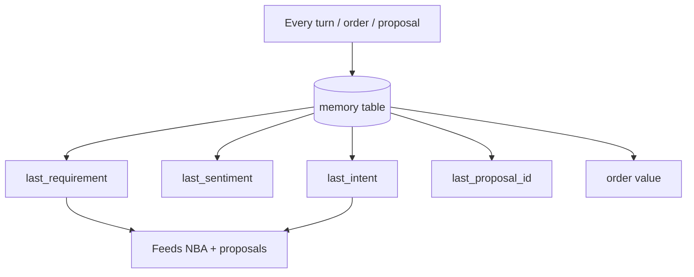

# Customer Memory Layer

**Code paths:** `backend/app/services/memory.py, backend/app/services/crm.py (remember/recall)`

## Purpose
Long-term memory of requirements, purchases, preferences, complaints, proposals, negotiations, agreements and communication history, persisted per customer and feeding proposals, predictions and next actions.

## Flowchart

## Notes
Every module runs with zero external services (SQLite + deterministic fallbacks) and upgrades automatically when PostgreSQL/Mongo/Kafka/Spark/Whisper/LLM keys are provided.
