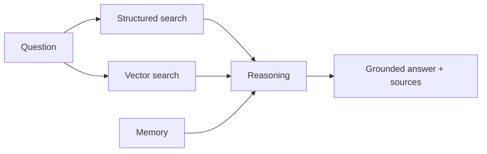

# RAG-Based AI CRM Assistant

**Code paths:** `backend/app/services/rag.py, backend/app/routers/assistant.py`

## Purpose
Dealers ask questions in natural language; answers are grounded in structured records and retrieved context.

## Flowchart

## Source
See `backend/app/services/rag.py, backend/app/routers/assistant.py` in this repository.
