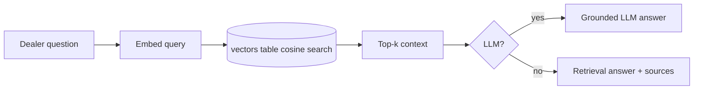

# RAG-Based AI CRM Assistant

**Code paths:** `backend/app/services/vectorstore.py, backend/app/services/rag.py, backend/app/services/llm.py`

## Purpose
Conversations are embedded into a persisted vector table. Dealer questions retrieve the top-k chunks by cosine similarity and are answered grounded in that context — with an LLM when configured.

## Flowchart

## Notes
Every module runs with zero external services (SQLite + deterministic fallbacks) and upgrades automatically when PostgreSQL/Mongo/Kafka/Spark/Whisper/LLM keys are provided.
