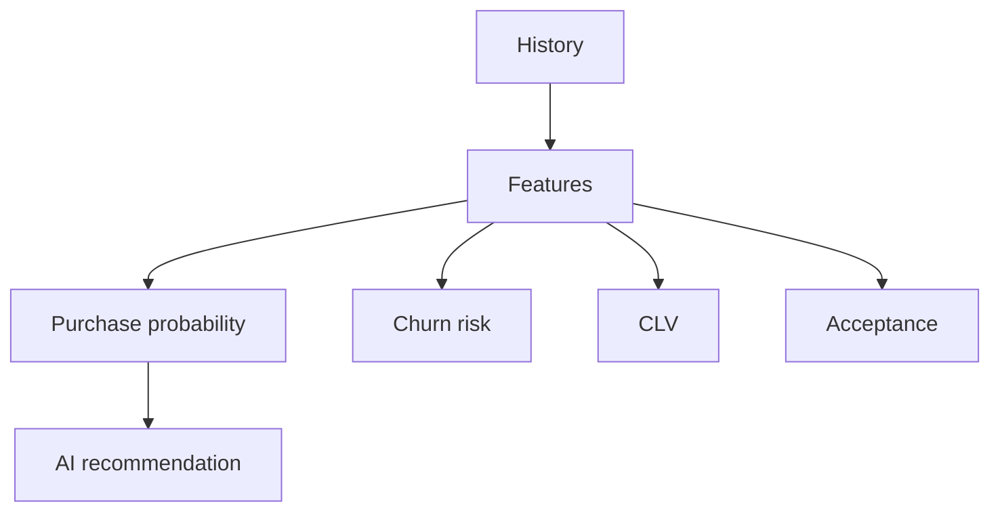

# Predictive Customer Intelligence

**Code paths:** `backend/app/services/predictive.py`

## Purpose
ML-style scoring of purchase probability, conversion, churn, CLV, proposal acceptance, engagement and preference.

## Flowchart

## Source
See `backend/app/services/predictive.py` in this repository.
