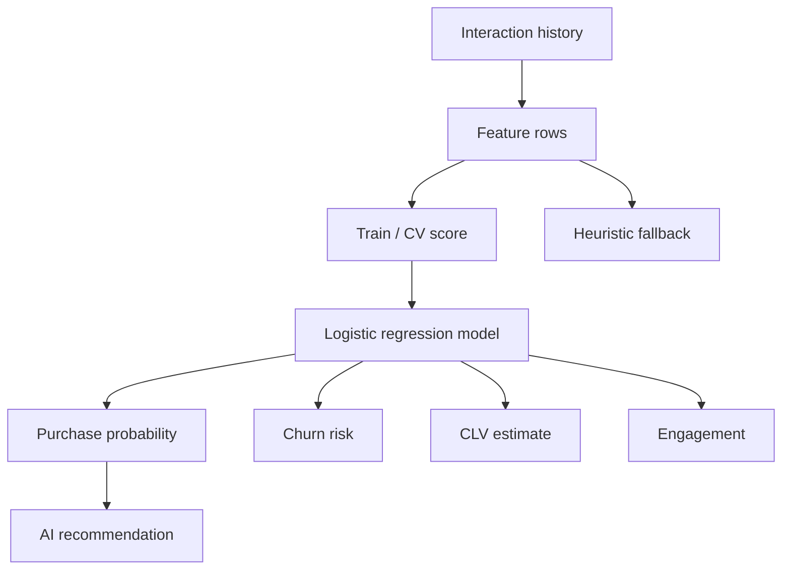

# Predictive Customer Intelligence

**Code paths:** `backend/app/services/ml.py, backend/app/services/predictive.py`

## Purpose
Feature engineering per customer (conversations, orders, spend, negative sentiment, priority) feeding a scikit-learn logistic-regression model for purchase probability and churn risk, with a transparent heuristic fallback.

## Flowchart

## Notes
Every module runs with zero external services (SQLite + deterministic fallbacks) and upgrades automatically when PostgreSQL/Mongo/Kafka/Spark/Whisper/LLM keys are provided.
