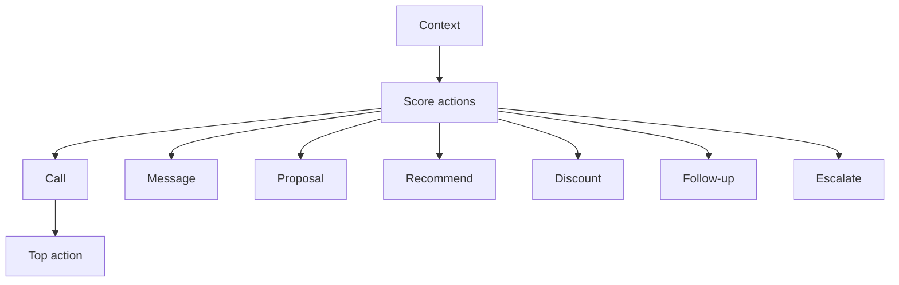

# AI Next-Best-Action Engine

**Code paths:** `backend/app/services/next_action.py`

## Purpose
Ranks candidate dealer actions using history, conversation, predicted behaviour and open requirements.

## Flowchart

## Source
See `backend/app/services/next_action.py` in this repository.
