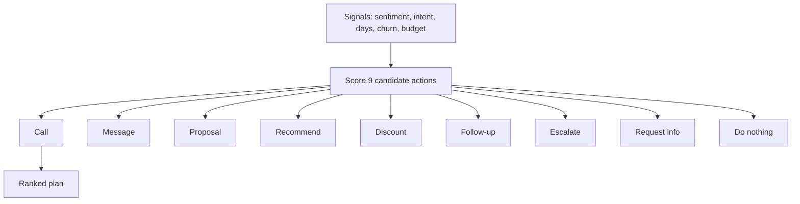

# AI Next-Best-Action Engine

**Code paths:** `backend/app/services/next_action.py, backend/app/agents/agents.py (NextActionAgent)`

## Purpose
Nine candidate dealer actions are scored from sentiment, intent, days since contact, pending proposals, churn risk and budget, then weighted and ranked.

## Flowchart

## Notes
Every module runs with zero external services (SQLite + deterministic fallbacks) and upgrades automatically when PostgreSQL/Mongo/Kafka/Spark/Whisper/LLM keys are provided.
