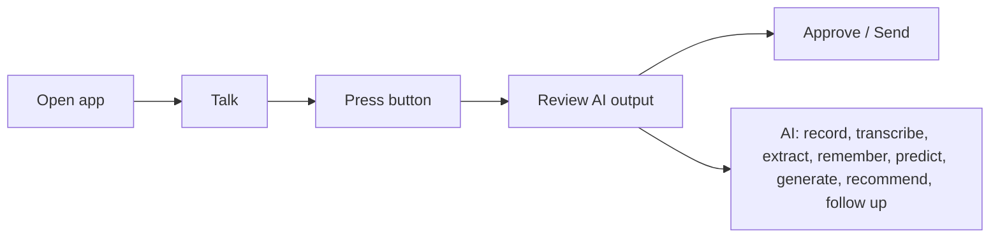

# Human-AI Interaction Model

**Code paths:** `frontend/app/chat/page.jsx`

## Purpose
The human only communicates, presses a button, reviews and approves. The AI performs recording, transcription, extraction, memory, prediction, proposal generation, follow-up preparation and CRM updates.

## Flowchart

## Notes
Every module runs with zero external services (SQLite + deterministic fallbacks) and upgrades automatically when PostgreSQL/Mongo/Kafka/Spark/Whisper/LLM keys are provided.
