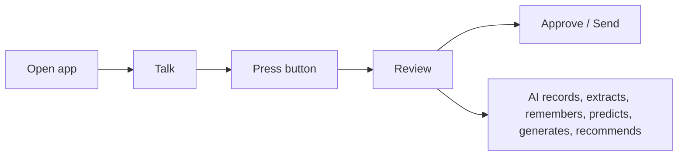

# Human-AI Interaction Model

**Code paths:** `frontend/app/chat/page.jsx`

## Purpose
The human only communicates, presses a button, reviews and approves; the AI performs every CRM operation.

## Flowchart

## Source
See `frontend/app/chat/page.jsx` in this repository.
