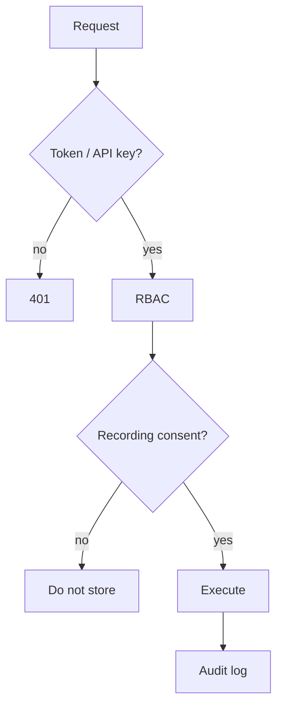

# Security and Privacy

**Code paths:** `backend/app/security.py, backend/app/main.py (audit middleware)`

## Purpose
Authentication, role-based access, per-consumer permissions, audit logging, consent and retention.

## Flowchart

## Source
See `backend/app/security.py, backend/app/main.py (audit middleware)` in this repository.
