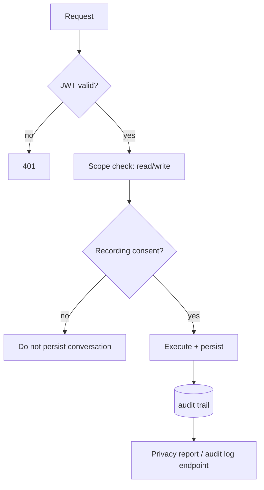

# Security and Privacy

**Code paths:** `backend/app/security.py, backend/app/routers/security_router.py, backend/main.py (telemetry middleware)`

## Purpose
PBKDF2 password hashing, HS256 JWT issuance and verification, RBAC scopes, per-consumer recording consent, and an append-only audit trail for every request.

## Flowchart

## Notes
Every module runs with zero external services (SQLite + deterministic fallbacks) and upgrades automatically when PostgreSQL/Mongo/Kafka/Spark/Whisper/LLM keys are provided.
