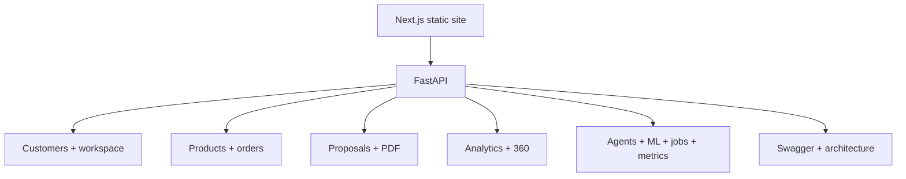

# AI CRM Dashboard & Website

**Code paths:** `frontend/app/*, backend/main.py static mount`

## Purpose
The public-facing site — dashboard, live chat, catalog, orders, proposals, customer 360 and a platform console — served by the API process so one URL exposes everything.

## Flowchart

## Notes
Every module runs with zero external services (SQLite + deterministic fallbacks) and upgrades automatically when PostgreSQL/Mongo/Kafka/Spark/Whisper/LLM keys are provided.
