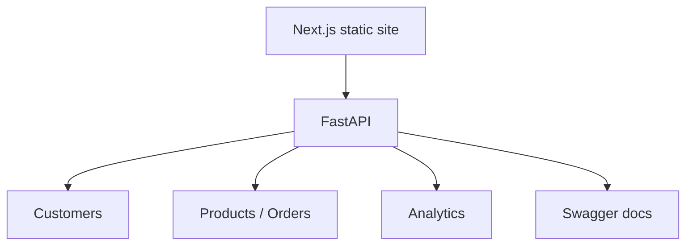

# AI CRM Dashboard & Website

**Code paths:** `frontend/app/*, backend/main.py static mount`

## Purpose
The public-facing site: dashboard, conversation view, catalog, orders and customer 360°, served by the API process.

## Flowchart

## Source
See `frontend/app/*, backend/main.py static mount` in this repository.
